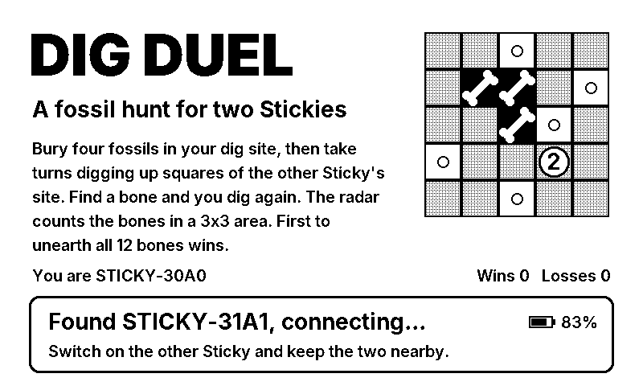
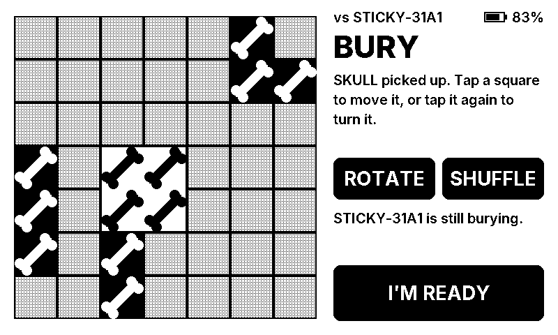
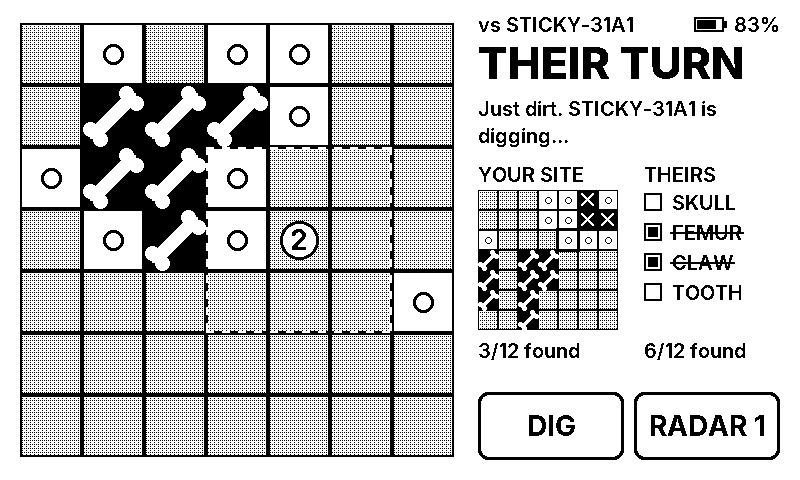
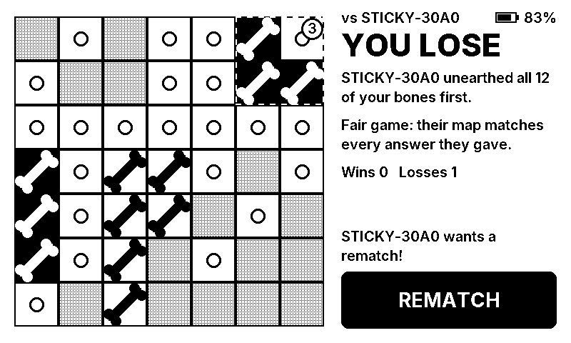

# Dig Duel

A two-player fossil-hunting game for the [Seeed reTerminal Sticky](https://www.seeedstudio.com/sticky/docs).
Two Stickies find each other over ESP-NOW and play directly, without a Wi-Fi
network, router or phone.

| | |
| - | - |
|  |  |
|  |  |

## Install

Open **https://mmeyer724.github.io/sticky-dig-duel/** in Chrome or Edge on a
desktop computer, plug a Sticky in with USB-C and click **Install Dig Duel**.
Repeat for the second Sticky.

Installing replaces the Sticky's firmware, including Seeed's note app. Seeed's
firmware can be reinstalled from [their firmware page](https://www.seeedstudio.com/sticky/playground/firmware/).

## How to play

1. Switch both Stickies on near each other. They pair automatically.
2. **Bury.** Your four fossils (skull 2×2, femur 1×3, claw L-shape, tooth 1×2)
   start in random spots. Tap a fossil to pick it up and tap a square to move it.
   Tap it again or press ROTATE to turn it, or press SHUFFLE for a new random
   layout. Press I'M READY.
3. **Dig.** On your turn, tap a square of the other site, then press DIG. Find a
   bone and you dig again; hit dirt and the turn passes.
4. **Radar.** Twice per game, press RADAR instead of DIG to count the bones in
   the 3×3 area around the chosen square. It uses up your turn.
5. The first player to unearth all 12 bones wins. Both Stickies then reveal
   their maps and check them against the answers given during the game.

The loser of a game digs first in the rematch. Wins and losses are kept across
restarts.

| Button | Action |
| - | - |
| AI, short press | Full redraw (clears e-paper ghosting) |
| AI, hold 2 s | Sleep. Press AI to wake. |
| Up / Down | Not used |

A Sticky sleeps by itself after 5 minutes alone in the lobby or 15 minutes
without play.

## How it works

- **Radio.** ESP-NOW on Wi-Fi channel 6. Each Sticky broadcasts a beacon that
  names the partner it wants; when two beacons name each other, the devices
  pair. Game messages then use a small reliable layer (`main/core/link.cpp`):
  sequence numbers, acknowledgements, retransmission, de-duplication and a
  random per-boot session id, so a rebooted device can't be confused with its
  old self.
- **Fair play.** Before the first dig, each Sticky sends a SHA-256 commitment
  to its layout plus a random salt. At the end it reveals the layout and salt,
  and the other Sticky checks the hash and every dig and radar answer it was
  given.
- **Display.** The SSD1677 e-paper panel is driven directly
  (`main/esp/epd.cpp`). Turns use the fast partial refresh, and every 20th
  refresh is a full one to clear ghosting. Everything is drawn in pure black
  and white so partial refresh is always possible.
- **Code layout.** `main/core/` is plain C++ with no ESP-IDF dependencies:
  rules, link protocol, game state machine and screens. `main/esp/` holds the
  hardware drivers and `main/main.cpp` the event loop.

## Build from source

Requires [ESP-IDF v5.4](https://docs.espressif.com/projects/esp-idf/en/v5.4/esp32s3/get-started/).

```bash
idf.py set-target esp32s3
idf.py build
idf.py -p PORT flash monitor
```

Host tests run the rules, the link protocol and complete two-device games over
a simulated radio that drops, duplicates and delays frames:

```bash
make -C test
./test/test_core --screens /tmp/screens   # also writes every screen as a PBM image
```

GitHub Actions runs the tests, builds the firmware and publishes the flasher
page to GitHub Pages on every push to `main`. To turn on publishing, set
**Settings → Pages → Source** to **GitHub Actions** once.

## Status

Version 1.0.0 builds cleanly and passes the host simulation. It has not yet
been tested on real hardware. If something misbehaves, the serial log
(`idf.py monitor`, 115200 baud) shows each tap, button press, game phase change
and display refresh, plus touch, radio and display start-up errors.

## Credits

- Pin assignments and the SSD1677 and GT911 setup sequences follow Seeed's
  [Sticky hardware overview](https://www.seeedstudio.com/sticky/docs/en/device-guide/hardware-overview)
  and ESP-IDF demo. The drivers here are new code.
- Text is rendered from the [Inter](https://github.com/rsms/inter) typeface
  under the SIL Open Font License; see `main/core/FONT_LICENSE.txt`.
- Browser flashing uses [ESP Web Tools](https://esphome.github.io/esp-web-tools/).
